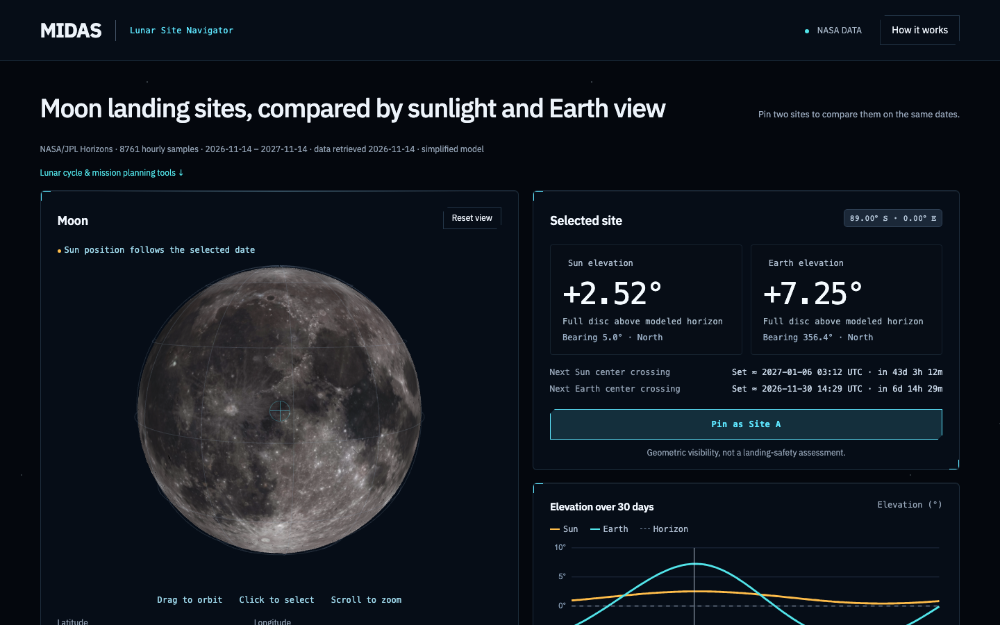

# MIDAS: Lunar Site Navigator

Compare Moon south pole landing sites by sunlight and Earth visibility, using NASA/JPL Horizons data.

Live site: https://pranavchilipiiiii.github.io/nasa_lunarmission/ (served from `main`)



NASA Space Apps Challenge 2026, team MIDAS (Austin, TX).

## What it does

- Pick any place on a 3D Moon, or enter coordinates. The panel shows the Sun's and Earth's elevation above a smooth modeled horizon.
- Pin two sites and compare them on the same dates and elevation scale.
- Move through one year of cached hourly data, or load a 30-day chart.
- Planning tabs: lunar phases, a panoramic surface sky, visibility windows, same-site date comparisons, and an illustrative scenario tab with visible assumptions.

## Run it locally

```sh
python3 -m http.server 8000
```

Open http://localhost:8000. Open the page through a server, not as a local file: it loads JavaScript modules and JSON data.

No framework, package install, account, or API key is needed.

## Data and method

- Sun and Earth positions: NASA/JPL Horizons, apparent azimuth and elevation as seen from the lunar surface. The raw responses and query URLs are saved in `data/`.
- Elevations use a smooth reference sphere of radius 1737.4 km. Terrain, crater rims, and eclipses are not modeled.
- Between hourly samples, values are linearly interpolated.
- The 3D Moon uses a NASA LRO texture. The surface relief is for display only.

Full sources and model assumptions: [SOURCES.md](SOURCES.md).

## Validation

Elevation comparisons against direct Horizons surface-observer output:

| Check | Comparisons | Worst Sun error | Worst Earth error | Worst sky-projected azimuth error |
|---|---|---|---|---|
| Round 1 (00:00 UTC, 11 dates) | 66 | 0.0008° | 0.0059° | not tested |
| Round 2 (07:30 UTC, 10 dates) | 90 | 0.0009° | 0.0046° | 0.0059° |
| Extended-range off-hour dates | 18 | 0.0008° | 0.0045° | 0.0054° |

Rounds 1 and 2 were re-queried from NASA Horizons. Their raw responses are in `data/validation-rounds-raw.json`, and `tests/validation-rounds.test.mjs` checks them against the shipped cache. Full scope and limits: [VALIDATION.md](VALIDATION.md).

These are sampled checks. They are not a global error bound.

## Limits

- Smooth-sphere model. Terrain, crater shadows, and mountains that block views are not included.
- Earth visibility is geometric. It is not a radio-link budget.
- Sun elevation is not generated power, and it is not a thermal forecast.
- The scenario tab uses hypothetical inputs. It is not an equipment or mission assessment.
- Supported dates: 2026-11-14 through 2027-11-14, UTC.

Not tested: iOS and Android browsers, and the optional HD model on low-memory devices.

## Glossary

- **Elevation:** the angle of a body's center above the horizon plane, in degrees. Negative means below the horizon.
- **Azimuth:** compass bearing measured clockwise from lunar north. Undefined at the poles and at the zenith.
- **Disc visibility:** the fraction of the body's apparent disc above the modeled horizon.
- **Center crossing:** the time a body's center rises above or sets below the horizon. Not first or last disc contact.

## Files

| Path | Contents |
|---|---|
| `index.html`, `styles.css` | Page layout and styles |
| `app.js` | Globe, controls, and integration |
| `math.mjs`, `math-additions.mjs`, `mission.mjs` | Calculations |
| `mission-ui.js`, `phase-moon.js` | Planning tabs and phase rendering |
| `data/` | Cached Horizons responses and parsed caches |
| `scripts/` | Data refresh and validation scripts |
| `tests/` | Node test suites |
| `assets/` | Moon textures and GLB models |

## Tests

```sh
node tests/math.test.mjs
node tests/math-additions.test.mjs
node tests/mission.test.mjs
node tests/moon-model.test.mjs
node tests/extended-validation.test.mjs
node tests/validation-rounds.test.mjs
node tests/validation-catalog.test.mjs
node tests/checksums.test.mjs
node --check app.js
node --check mission-ui.js
node --check phase-moon.js
```

Tests need Node.js 18 or newer.

## Refresh the data

```sh
python3 scripts/fetch_data.py          # one-year cache, needs network
python3 scripts/validate_rounds.py     # rounds 1 and 2 raw responses, needs network
```

Each script replaces the cached output it writes. Inspect the diff before committing.

## Contributing

See [CONTRIBUTING.md](CONTRIBUTING.md) for the branch workflow, file ownership, and deployment notes.

## AI use

This project was built with AI assistance (Claude and Codex). They helped with research, information gathering, visual design, and image creation.
